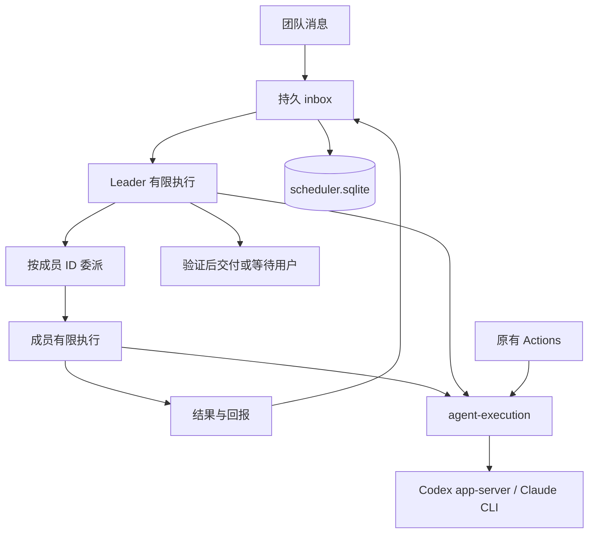

# Agent Loop 团队协作

状态：UnderControl 0.17.0 的 Teams / Agent Loop。已有安装版需要手动更新。[验证记录](job/agent-loop/03-phases.md)区分原始固定阶段原型与当前消息驱动流程。

## 团队、成员与消息

Teams 与 Sessions、Actions 并列。创建团队只填写名称，存储与内部执行目录均由 UnderControl 管理。用户直接在消息框说明目标，服务建立内部任务；独立新应用或其他产物可在托管执行目录直接创建，操作已有项目时再指定项目路径和分支，无须新建任务表单。新团队默认有 Codex Leader，可从成员中更换。

用户未指定收件人时唤醒 Leader；显式 `@成员` 直接派发给选中的稳定成员 ID，不先转交 Leader。多个明确收件人可各自执行，不广播唤醒其他成员。成员通过 `send_message` 互相委派、求助或回复。未填写 mentions 的 reply 默认回复本次委派来源；执行结果返回实际请求者；仅需要协调时通知 Leader，不因普通完成确认唤醒。Leader 在成员工作结束后汇总、安排后续工作或交付。普通回复不自动形成新的委派回调，避免无任务的互相确认循环。等待用户时不保持模型轮询。Leader 请求 wait 时，如仍有排队或运行中的成员，Task 保持 active，成员凭据和结果回传继续有效；成员结果交回实际请求者处理后，确实只剩用户输入时才进入 waiting。用户显式暂停、取消或修订仍立即撤销旧执行凭据。每个指派只设一个负责成员与明确产出，不重复派发其他成员的职责；`submit_result` 已自动回传，无须额外发送完成通知或确认。reply 消息立即落盘显示，在发送者退出后交接；与该次完成通知合并为一次唤醒。先恢复待处理的成员工作链，再让 Leader 汇总，避免双方抢着处理同一结果。

Teams 的 Codex 进程统一使用完整访问，不再按 Leader、讨论、实施或验证角色强制设置只读或目录写入白名单。Leader 可直接完成当前职责，也可用 `send_message(intent=delegate,write_access=true)` 委派实施；`write_access` 用于实施分类与目录占用调度，不是权限授予开关。用户明确要求只读时，成员仍须遵守任务约束。Leader 按任务选择验证方式，检查实际实现与验证证据；独立验证在有必要或用户要求时安排，不再强制另起验证 Run 或要求结构化 pass 作为交付门槛。未结束成员仍需完成或明确处理后才能交付。服务不会仅凭 CLI 退出成功认定交付，也不会把文本中的“完成”当作状态。Leader 明确请求 `deliver` 且其执行成功后，任务进入 `review`，界面显示“已交付”。用户可完成归档，或继续发送修订要求。

团队有未结束工作时不能更换项目或 Leader；可更换资料备份目录以处理磁盘问题，保留旧资料。交付后更换设置，下一条消息使用新设置建立内部任务，保留先前交付记录。

## 引导式创建

新建团队可选择“引导式创建”：输入需求及可选项目目录，由现有 Runtime 生成团队草案。草案可调整名称、任务理解、验收要求，以及成员的定义、职责、头像、客户端、模型和 effort。第一位成员担任 Leader；可增删其他成员，人数由所需专业职责决定，不设置组队人数上限。原有手动创建、复制房间和目录恢复入口保留。

规划 Agent 通过只读 search_agents 工具主动搜索全部已启用 Marketplace 来源的 Agent 池，再用 get_agent_definition 读取候选原文，确认专业能力与职责匹配。本地文件及安装状态不是检索范围或排序优先条件；搜索按页返回，可继续检索，不把最初一组候选当成全部角色池。界面与原生 Session 均可查看实际搜索词、匹配结果和定义读取记录。协调 Leader 或充分搜索后仍缺失的专业职责可生成专用角色，明确标记“按需求生成”。外部定义保留原文、来源、版本和许可证，生成时不安装。确认创建时才安装选中的市场定义，并复核本地内容及模型能力；不覆盖本地修改。规划客户端仅进行只读组队，业务执行仍使用 Teams 原有权限。Claude 成员继续受既有讨论与审阅范围约束。

“仅创建”事务内保存团队和全部成员，不启动工作；“创建并开始”再把原始需求与组队阶段的用户补充交给现有 Leader 消息入口。重试沿用请求标识，不重复生成、建队或启动。方案及原生 Session 引用保存在现有数据库的 loop_team_plans；刷新保留当前浏览器的编辑草案，服务重启将未完成规划标为中断，等待用户重新生成。原生规划执行最多五分钟，同时只运行一个规划，最多接收四项；这些限制不改变已有 Teams 的业务调度。

生成方案后可继续补充意见，并把已编辑方案作为下一轮基线。保留历轮沟通、来源和原始版本；调整中保留当前草案，失败或取消不会清空。新增但未填完整的职责允许交给规划 Agent 补全，确认创建时仍要求完整有效的配置。每轮规划独立保存，原生 Session ID 可追溯；对话上下文由应用传入，不声称复用了同一个原生 Session。此流程用于确认创建之前，不自动替换已创建团队的成员或会话。

接口使用现有本地管理端口：

| 方法与路径 | 输入或结果 |
|---|---|
| POST /api/v1/teams/guided-plans | request_key、requirements、可选 workspace、runtime_id、model、effort；立即返回 plan，不等待模型完成 |
| GET /api/v1/teams/guided-plans/:id | 状态、实际阶段、草案、候选来源与原生 Session 引用 |
| POST /api/v1/teams/guided-plans/:id/refine | request_key、feedback 和用户已编辑的 draft；返回新的规划版本，保留原方案 |
| POST /api/v1/teams/guided-plans/:id/tools/search_agents | 本轮临时凭据限定的只读 Agent 池搜索；query、可选 source_id、offset、limit |
| POST /api/v1/teams/guided-plans/:id/tools/get_agent_definition | 本轮临时凭据限定的定义读取；agent_id |
| POST /api/v1/teams/guided-plans/:id/cancel | 停止尚未完成的规划 |
| POST /api/v1/teams/guided-plans/:id/create | 编辑后的 title、summary、acceptance、members，confirm=true，start 控制是否开始；返回现有 room |

## Agent 定义来源

成员选择器通过 `agent-catalog.mjs` 读取本地全局定义及组合层注入的 Marketplace 托管安装。市场发现、安装与更新统一在 Teams 的全局 Agent 管理中，详见 [Marketplace](agent-marketplace.md)。原目录 API 保留以下来源供既有调用方使用：

| 来源 | 读取内容 |
|---|---|
| 本地全局定义 | `~/.agents/agents`、`~/.claude/agents` 下的 Markdown，以及 `CODEX_HOME/agents` 下的 TOML。未设置 CODEX_HOME 时使用 `~/.codex/agents` |
| ECC · Everything Claude Code | [官方 MIT 仓库](https://github.com/affaan-m/ECC) 的 agents/*.md，在线发现目录，按固定 Git commit 读取定义 |
| Agency Agents | [MIT 开源角色目录](https://github.com/msitarzewski/agency-agents)，导入固定 Git commit 的定义 |

原目录的市场来源通过 GET /api/v1/agent-catalog/sources 返回；成员区 + 不再调用此接口。ECC 和 Agency Agents 分别读取 main 当前 commit 及对应 Git tree，不内置角色名单；目录各缓存 10 分钟，并发读取合并请求。点击刷新调用 refresh=1 立即重新获取上游版本，刷新失败保留已有目录和用户配置并显示错误。本地定义、已导入文件和团队成员快照不随市场刷新改变。ECC 只接入 agents 根目录的角色 Markdown，不安装其插件、hooks、rules 或 skills。

相同真实目录只扫描一次，同名角色合并客户端变体。Codex 实际目录的 TOML 优先于共享目录中的 TOML。本地目录按请求读取，因此刷新列表能看到定义更新。目录当前读取根目录下的定义文件，不递归扫描子目录。

成员保存名称、描述、完整角色指令、模型、声明的 tools/skills 和来源快照。来源包含路径或 URL、内容摘要，以及远程定义的 commit 和许可证。目录浏览只读取角色数据。原 import HTTP 接口保留“添加到全局”语义，将完整 Markdown 定义写入 `~/.agents/agents` 的真实目录，再允许“加入团队”。如果该路径是符号链接，返回实际落盘路径。写入使用临时文件、fsync 和不覆盖目标的原子 link，重复导入返回同一文件，任何同名不同内容或客户端变体都报冲突。不运行远程脚本，不覆盖已有定义，不修改客户端配置。来源、原内容摘要、revision 和许可证保存在 `undercontrol_source` 中。导入后全局定义的后续变化不会改写成员快照。ECC 导入使用 ecc-<slug>.md（例如 ecc-planner.md）以避免与同名用户角色混淆；上游定义更新后也不会覆盖已有本地版本，同名不同版本明确报冲突。

对本机发现的未加引号的单行 Markdown `description`，读取时在内存中规范化后重新解析 YAML；保留原始文件摘要和角色正文，来源标记 `normalized_metadata`。其他损坏文件单独报错，不阻止有效角色显示。

现行 Marketplace 安装保存在 UnderControl 的 agents/installed，不写入上述全局目录；托管角色按 managed: ID 进入成员选择器，更新由安装管理审核，旧成员保留自己的版本快照。

角色声明不能扩大团队执行权限。Claude 的模型别名不会直接传给 Codex。GitHub 返回 403 或 429 时，目录显示受限提示和重试入口，本地定义仍可使用；网络失败不会转换成空目录或示例数据。

## 输入组件

团队输入采用 [Kibo UI Editor](https://www.kibo-ui.com/components/editor) 的精简 Provider 结构，使用 Tiptap 3。`components/kibo-ui/editor` 保留上游 MIT 许可证，仅启用消息需要的段落、换行、撤销、占位和长度限制。

`@` 使用官方 [Tiptap Mention](https://tiptap.dev/docs/editor/extensions/nodes/mention)，候选选择使用 shadcn Command 的 cmdk 组合。弹层挂载、光标锚点和退出由 Tiptap Suggestion 管理，方向键选择由 cmdk 管理。应用弹窗仍使用 Base UI，没有启用 cmdk Dialog。

选择成员后，Mention 节点保存稳定的 member ID 和显示名称。HTTP 请求中的 `mentions` 从节点读取并与当前团队成员核对，不对普通文本做正则路由。粘贴普通 `@名字` 文本不会自动获得投递身份。消息阅读使用已保存的 mentions ID 确认收件人，在 Markdown 普通正文中匹配对应名字，显示为可点击的行内提及，打开该成员的定义。代码、链接和邮件地址不转换；未出现在正文、已改名或同名的已登记收件人直接以蓝色 @成员 插入正文首段行内，不推断未登记身份。Agent 消息从持久化 agent_message 事件保留 intent，不增加单独用途徽章；指派与验证仅通过正文行内 @ 表达，不增加指派或验证标签，不把 mention 藏进工具参数或弱化收件人行。旧记录没有动作凭据时不根据正文或角色猜测动作。广播不派发执行。已移除成员保留可读标签。普通 @ 文本不会因此变成路由指令。发送期间短暂禁止编辑，失败时保留草稿与重试标识。Enter 换行，Command/Ctrl+Enter 发送，候选菜单中的 Enter 确认成员。

Kibo 的完整文档工具栏、表格和代码高亮不属于消息框需求，未引入对应 UI。Kibo 原 AI Input 文档目前转到 AI Elements；本次没有因此新增 AI SDK 传输层。

## 团队界面与看板

Teams 使用局部深灰主题，不改变 Sessions 和 Actions。1440px 时左栏 200px、右栏 248px，团队页头 54px，正文 14px。小于 950px 时成员进入抽屉，小于 600px 时导航进入抽屉。用户消息在右侧显示完整气泡，Agent 消息在左侧开放排版。角色姓名为主要身份，CLI 是次要标签，所有关联使用成员 ID。

顶部“对话 / 看板”切换当前团队的中间区域，左侧仅保留团队列表，不提供重复的看板入口。看板采用 Kibo UI Kanban 的 KanbanProvider、KanbanBoard、KanbanHeader、KanbanCards 和 KanbanCard，依赖 dnd-kit 及 tunnel-rat。保留上游 MIT 许可证，并修正不可变数据更新、空列拖放、取消与排序行为。卡片在 1100px 以下为两列，600px 以下为单列，人工卡片另有原生状态选择器供键盘和触屏使用。

实体的语义分别为：

| 实体 | 含义与状态来源 |
|---|---|
| 协作 Task | 用户消息触发的一次完整协作，由 Leader 和执行结果推进 |
| Agent Run | 某位成员的一次受控执行，由原生进程结果推进 |
| 会话卡片 | 从 Task、委派待办、执行和正式报告读取的工作视图，状态跟随真实记录 |
| 人工工作项 | 用户整理的记录，可拖动或选择状态，不自动创建 Task 或 Run |

看板固定 backlog、working、review、done 四列，分别显示待处理、进行中、待验收、已完成。当前团队的会话目标使用 T- 编号，delegate/verify 工作使用 W- 编号；其稳定 ID 直接关联原 Task 或 inbox，不写入 loop_work_items，也不按 Run 创建重复卡片。续接通过成员拥有的 assignment_id 归入同一项工作；不同的新指派保留独立卡片，不按文本相似度合并。普通聊天、ask、reply、announce 不另建工作卡，相关问题在工作详情展示。历史工作随已持久化事实恢复，无须重跑 Agent。

会话卡片的排队、目录等待、执行、依赖阻塞、等待答复、暂停、失败及取消分别展示。正式报告已交付进入待验收，原生执行成功不推断为验收通过；结构化 fail 保留“验收未通过”及原报告。Task 的 review 表示待用户验收，用户归档后目标卡进入已完成，失败结论不会被改写为 pass。卡片详情包含来源工作、负责人快照、要求、依赖、问答及正式报告摘录。点击“查看对话”选择对应协作，不发送消息；不承诺精确滚动到原消息；完整委派正文保留在工作详情中，早于当前消息窗口的会话正文不承诺已加载。事件更新会重新读取看板，不依赖人工 revision 增长。

人工记录使用 R- 编号，仍由用户编辑和排序。人工卡片 review 表示待人工核对，任务归档不移动人工卡片，人工卡片返工也不自动恢复 Agent。“在对话中继续”只填入草稿，由用户发送后才进入协作。会话卡片不提供人工改状态或拖动，服务拒绝通过人工更新接口改写它们，避免显示状态脱离真实执行。

人工工作项支持名称、类型、负责人、说明、搜索、筛选、列内排序和跨列移动。owner_id 必须属于当前团队。排序请求仅包含全部人工卡片及 expected_revision，服务在一个事务中核对并保存。版本不符返回 LOOP_BOARD_CONFLICT，防止多个页面相互覆盖。失败时前端回滚并重新读取真实状态，保留错误提示。创建 request_key 防止重复添加。

团队视图写入 URL 的 team_view 参数。Command/Ctrl+K 搜索团队及当前已载入的消息，界面明确检索范围，不声称全文检索。没有接入原型的浏览器演示存储或定时推进。

## 成员定义与模型

本地角色可直接加入团队。市场角色先成功落盘，再加入团队，两步均不会启动 Agent。同一定义不能通过重复点击或切换客户端加入两次；同参数重试返回原成员，不同配置报 LOOP_MEMBER_EXISTS。

成员 execution_config.model 为 null 时跟随客户端当前默认模型，字符串表示本成员的模型覆盖。模型默认值不从角色定义中强行带入。旧成员没有 execution_config 时保留其原有 profile.model 行为。切换客户端会清空尚未保存的指定模型。

指定模型须出现在 registry 返回的 live 模型列表中，否则返回 LOOP_MODEL_UNVERIFIED。回退列表不作为可用性证明。当前 Claude 适配没有 live 模型目录，只开放默认模型，并显示这一限制。客户端不可用时拒绝加入，不修改全局认证或模型默认设置。

点击成员通过团队 ID 和成员 ID 读取定义。优先展示加入时的 profile 和实际 instructions 快照；旧记录缺少快照正文但有 local 定义标识时，读取关联本地定义并标明来源。未关联或读取失败时明确提示，不以职责简介替代。成员当前模型单独显示，不被定义中的默认模型覆盖。“在对话中提及”向现有 Tiptap 编辑器插入稳定 ID 节点，保留原草稿且不会自动发送。

成员行点击主体查看定义，更多菜单提供提及和更换 Leader；当前 Leader 或未结束协作期间不能切换。头像状态区分客户端可用、不可用和实际执行，不再为每行放置皇冠按钮。全部 Teams 弹窗底部按钮统一为 88×32px，触屏高度至少 44px。本地角色选择器宽 480px；选中后打开宽 620px 的团队身份配置弹窗，不再使用市场与成员配置混合的双栏弹窗。成员定义弹窗宽 620px，正文独立滚动，头部和操作区固定可见。成员的“在线”数字表示其运行客户端可用，提示中明确不是常驻 Agent 进程状态。

## 持久调度与共同执行

`execution-database.mjs` 提供同一个 SQLite 连接，daemon 最终关闭连接。Actions 和 Teams 分别拥有记录及生命周期，共用 `agent-execution.mjs`、底层 supervisor 和真实目录占用协调。协作服务不包装 RunService，也不把 Task ID 当成 Schedule ID。

| 表 | 内容 |
|---|---|
| `loop_rooms`、`loop_members` | 团队设置、Leader、成员角色、来源快照及模型配置 |
| `loop_boards`、`loop_work_items` | 独立的团队工作项、状态、顺序和保存版本 |
| `loop_tasks` | 内部目标、项目、输入版本和暂停代次；旧固定阶段任务另有预算 |
| `loop_messages` | 用户及成员消息，包含明确的接收成员 ID |
| `loop_inbox` | 持久待处理消息、派单及结果通知，分别记录领取、原生投递及工作处理状态 |
| `loop_runs`、`loop_outbox` | 一次有限执行、路由、原生 Session ID、结果及派发状态 |
| `loop_memories` | 带消息或 Run 来源的决定与摘要；决定仅由 Leader 记录 |
| `loop_memory_sync` | 与业务变更同事务增加的资料版本及成功导出版本 |
| `loop_events` | 委派、进度、版本化正式报告、证据读取、执行计时和交付事件 |
| `execution_resources` | Actions 与 Teams 共同的真实目录占用 |

消息、inbox 和派发记录在同一事务内保存。完成结果和下一次派发也在同一事务内保存。每个任务中的同一成员最多有一个未结束 Run，Leader 等待成员结果时合并通知。继续 conversation 任务时，未启动的 queued 指派保留原 ID、依赖和消息关联，并同步到新的执行代次，避免旧代次使领取永久失败；已启动或未知进程仍先核实退出，不自动重放。重复 request key 不重复投递，正文或接收成员变化则报冲突。Teams 聊天协作不再使用默认 24 次执行或每次 600 秒的硬截断，旧 conversation 记录中的这两个值也不再阻断续接。用户暂停、取消及实际客户端故障仍按真实状态处理；去重、无动作续接限制和资源占用继续防止重复派发。旧固定阶段任务与 Schedule 的显式预算及超时保持原行为。

`loop_schema` 当前为 7。从版本 1–6 增量迁移；版本 7 增加消息关联与 inbox 的投递、处理状态，版本 6 引入独立全局定义删除日志表，其余迁移添加成员头像、历史身份快照、消息文件引用和运行内容。历史 Run 和已消费 inbox 不再依赖仍存在的成员行，真删除成员后仍能读取和迁移历史；迁移保留全部记录。Actions Run 的 `PRAGMA user_version=5`；与 loop_schema 独立。旧固定阶段任务保留原有执行语义和接口，新的聊天使用 `workflow: conversation`。

原生会话仍由客户端保存，Run 引用 Session ID。Teams 的同一成员在同一 Task 版本、客户端及任务目录续接自己的会话，讨论、实施和验证切换不另建会话；明确修订任务或更换客户端后重新开始；其他成员不会继承该成员的私人上下文。成功投递游标只在 provider 接受 turn 或执行成功后推进，不以新建 Run 代替投递回执。限流、网络或认证失败不会改成新会话重试；续接失败进入等待并保留错误，当前不自动删除或重建原生会话。成员间委派不是原生 fork 或父子关系，不篡改原生关系。

## 团队资料与恢复

SQLite 是团队消息、任务、决定、摘要与执行状态的持久存储。用户不需要指定记忆目录。文件目录只提供可迁移的资料备份，默认由 UnderControl 管理；`room.json` 保存完整团队、成员定义快照、Task、Run、消息、inbox、事件、工作项、决定及摘要，附格式版本和 SHA-256 校验。文件快照在 `artifacts/<sha256>`。不会把 Run token hash 或客户端认证配置导出。

业务变更与 `loop_memory_sync.revision` 在同一 SQLite 事务保存。团队修改在数据库提交后成功返回，资料备份在后台异步同步，不作为发送消息或启动执行的前置条件。导出使用临时文件、fsync、原子 rename 和目录 fsync。备份失败保留未导出版本，界面显示提示并可重试，对话与执行继续。显式调用同步接口失败时返回 LOOP_MEMORY_SYNC_FAILED。每个团队独立同步，不阻止其他团队继续使用；重启后继续同步。目录另持有 SQLite 写锁，避免两份服务同时写；进程退出后由系统释放锁，不依赖租约过期或猜测 PID。

新建界面不显示存储目录；daemon 使用数据目录下 `rooms/memory/<room-id>`。现有团队在服务启动时增量补齐默认目录，保留任务及启停状态。团队设置的“资料存储（可选）”可指定备份目录，清空后恢复默认；不影响原有资料。恢复也可不填写目标目录，由服务分配默认位置。创建请求保留 request_key，重复请求返回同一团队；默认 Leader 与团队在同一事务创建。新建不会覆盖已有团队资料，应使用“从目录恢复”。恢复先核对格式、校验值、团队归属和引用，再在事务中重建记录；保留稳定 ID 和原始资料，不自动派发。未结束任务变成 paused，已领取或未执行的 Run 变为 unknown，撤销凭据并清除跨进程 PID。需要重新指定本机项目目录。

团队目录不搬迁 Git 仓库、未提交代码及客户端原生 Session 日志。已迁移任务不能直接重放旧工作目录；确认旧执行后，可在恢复的团队发送消息，由服务分配本机内部执行目录并按需准备项目，并按需读取原决定、历史和已提交产物。原始项目改动须单独迁移。文件在提交前已经缺失或不可读取时，资料标记 unavailable，不伪造产物成功；归档文件在恢复时校验内容哈希。

模型初始输入包含最近消息、结果索引和记忆。续接原生会话时，通过输入快照中的 result_cursor 只补充上次投递之后完成的结果，不反复注入旧汇报；角色定义未变化时沿用已投递的完整指令。结果索引保留简短汇报、产物和 Run 引用。`read_context(section=results,source_run_id=精确 Run ID)` 返回该 Run 保存的全部公开助手正文（public_messages，受 Run.parts 容量限制）、结构化结果与截断标记；不得仅凭最后一句完成说明断言正文或源码不存在。该查询只能访问当前 Task。`read_context(section=messages|results|memories, before, limit, query)` 可读取更早完整内容；每页最多 50 项、约 64 KiB，next_before 为下一页游标。记忆必须引用当前团队消息或当前任务 Run，摘要不构成授权。 Teams 默认记忆上下文优先保留当前任务版本的决定，再按本轮指派与目标的中英文关键词匹配筛选。最多 20 条、合计 12,000 字符，每条正文预览最多 2,000 字符，长内容标记 truncated；原记录与来源完整保存，read_context(section=memories,source_memory_id=...) 可精确读取原文。该筛选使用 SQLite 和本地分词，不调用额外模型，不引入向量数据库。remember 可用 supersedes 明确替代本团队同类型旧记忆；被替代记录不再默认注入，仍保留历史与备份，精确读取返回 superseded_by。替代关系进入既有 memory_recorded 事件，重复请求不得改变关系。历史记忆不覆盖当前用户要求，系统不自动推断两段文字互相矛盾。`section=artifact` 使用 source_run_id、reference、offset，按最多 32 KiB UTF-8 正文读取；返回 next_offset，二进制仅返回元信息。

## 执行权限和恢复

Codex 使用每个 Run 独立的 app-server，Skills 和 integrations 继承客户端已有配置，不强制关闭网络；不修改全局配置。用户已明确授权的动作无需重复确认，Teams 的 Codex 在 thread/start、thread/resume 使用 danger-full-access，并在每次 turn/start 显式传入 dangerFullAccess 与 never，避免历史原生会话继续沿用旧沙箱。此设置不写入全局客户端配置；旧固定阶段任务及 Actions 的 sandbox 设置不变。系统账户权限及运行时实际工具能力仍生效。新任务先分配数据目录下 `rooms/workspaces/<request-hash>`，CLI 始终在这个稳定内部目录启动，不依赖 Git 或用户配置的项目。此目录可保存任务产物及独立新应用源码，不要求 Git、项目绑定或用户先指定路径；修改已有代码项目时通过 prepare_projects 准备，追加资源不会改变内部目录或成员的续接位置。Leader 仅在现有项目目标不明时询问路径，期间可继续独立设计和评估。适合的无依赖工作可并行，目录写锁仍限制并发写入。

| execution_mode | 行为 |
|---|---|
| isolated | 默认策略；从 HEAD 创建新的 undercontrol/loop-* 分支及 worktree。显式 branch 可指定起点引用，不会静默改用 HEAD |
| existing_branch | 继续已存在的本地分支；优先复用 Git worktree list 中检出该分支的目录，否则在该分支创建 worktree，不另开分支 |
| in_place | 根据明确要求使用给定原目录，不创建 worktree、不切换分支，保留已有改动。非 Git 目录仅支持此显式策略 |

提供 branch 而未提供 execution_mode 时按 existing_branch 处理。项目路径与分支从当前任务及已有上下文确定，不做用户消息中的字符串匹配，不要求重复确认或原样粘贴。existing_branch 不自动 fetch、创建远程跟踪分支或退回 HEAD。in_place 若指定的分支与当前分支不同，返回错误；不会自动 stash、reset 或 checkout。准备时记录实际分支、base_commit 和 dirty，核对实际 Git common directory 与分支归属。同一任务可通过 prepare_projects 显式重新选择分支或执行方式，按 source_workspace 替换原资源位置，保留项目编号，不要求结束任务。该操作复用或准备指定分支，不自动 stash、reset、改写文件或切换已占用目录的分支。

资源占用一次性取得内部目录及全部项目目录。Teams 的 Codex 不附加 sandbox writable roots，Git 可正常更新主仓库元数据及 worktree 父目录；Claude 通过 add-dir 读取准备好的项目，当前适配器仍只允许只读工具，不宣称支持实施。历史任务保留已有工作目录和记录；后续新任务统一使用内部目录。目录准备失败不降级到其他位置，不自动提交、合并、发布、删除成果或覆盖现有改动。隔离模式从提交快照创建目录，未提交内容不自动复制；原目录与已有 worktree 模式保留原内容。旧队列引用缺失目录时记录失败并等待处理，不反复占满派发并发位。

Claude Code 通过 stream-json CLI 执行，只开放 Read、Glob、Grep，关闭 hooks，并仅连接本次 Run 的 MCP。当前只用于讨论与审阅，不开放 Claude 写入。真实 Claude 模型响应曾超时，尚未完成模型侧交付验收；结构化 `is_error` 优先于退出码 0。

领取派发记录后先持久化 `starting`，再启动原生进程。重启时已领取的 Run 转为 `unknown`，不会自动重放。未领取队列可继续。暂停、取消和修改目标撤销 Run 凭据；旧结果必须匹配 revision 与 generation 才能推进。

目录占用按真实路径及父子目录判重。Teams 依据 resource_scope 选择目录与访问方式，Leader 统筹默认只观察内部执行目录，不因身份取得全部项目写占用；观察性审查允许其他会话编辑，实际写入之间仍互斥。调度先检查资源再领取运行名额，工作默认并发 2，另保留默认 1 个协调名额，配置见下文。同一成员在同一 Task 中最多一个未结束执行。PID 不明或仍存在时不按超时释放，未知执行先核对旧进程，不自动重放。Actions 与旧固定阶段任务保持原有目录占用语义。该协调只覆盖 UnderControl 启动的工作，不控制用户手动启动的外部写入者。

## Run 专用 MCP

`mcp/src/loop-server.mjs` 构建为 `server/vendor/loop-server.mjs`，随现有 vendor 流程打包。仅向本次受控进程注入，不安装全局插件，不改变原有 `session_*` 和 `schedule_*` 工具。

| 工具 | 行为 |
|---|---|
| `read_context` | 默认读取快照；messages、results、memories 提供正文分页与字面关键词查找；results + source_run_id 精确读取公开助手正文和结果；artifact 按 Run 与引用读取已归档产物 |
| `remember` | 保存 decision 或 summary、来源消息/Run ID、request_key；可用 supersedes 替代同类型旧记忆，原文保留；只有 Leader 能记录决定 |
| `report_progress` | 保存有来源执行 ID 的内部进度事件，notification=internal_only，不写聊天消息、不唤醒成员；供恢复时重建工作进度 |
| `send_message` | 使用成员 ID 委派、验证、提问、关联答复或告知；告知不启动收件人 |
| `submit_result` | 可选的结构化结果与相对产物路径，退出后自动交接；使用验证汇报时须为 pass 或 fail。Teams 原生成功不因缺少此调用而失败，旧固定阶段任务仍要求提交 |
| `request_action` | 当前 Leader 请求 prepare_projects、wait、deliver 或 cancel_assignment；接收人或 Leader 可 reconcile_delivery 核对未知投递，旧固定流程支持 advance |

`request_action(action=prepare_projects)` 使用 workspaces，以及可选 execution_mode、branch；不再使用 source_message_id 或 LOOP_PROJECT_SOURCE_INVALID。Leader 可直接采用任务、对话、需求文档与已有工作区上下文中已经明确的目录，不要求用户在某一条消息原样填写或再次确认。仅在无法判断实际目标项目时询问；目录存在性、真实路径、Git 分支和 worktree 仍按实际状态检查。没有已准备项目或历史绑定时使用绝对路径或 ~/ 路径；有项目后可使用相对路径。只有当前 Leader 可操作；可在无关成员执行时追加项目，也可显式更新已有项目的绑定，不修改已启动进程的目录快照。分支/worktree 改名应协调该项目成员先结束工作。服务在准备项目时保存 Git 管理目录与项目相对路径，在执行前后依据 worktree 的 gitdir 指针刷新实际分支和目录；base_commit、项目顺序与原生会话位置保持。刷新采用旧值比较，避免覆盖异步期间新选的绑定。旧记录在目录仍存在时补齐标识；旧路径已缺失且没有标识时不猜测目标，可通过 prepare_projects 明确选择实际分支或目录恢复。幂等请求不会重建工作区。资源追加到当前 Task，最多 8 个项目，不会改变稳定 CLI 目录，下一轮仍续接同一 Task。代码任务缺少明确项目路径时在团队询问；非代码任务可在内部执行目录直接完成。

常见参数示例：继续用户指定的本地 feature/foo 分支时，用 `execution_mode: existing_branch, branch: feature/foo`；明确要求原目录执行时用 `execution_mode: in_place`；基于 develop 隔离执行时用 `execution_mode: isolated, branch: develop`。

`send_message` 的 `intent` 为 delegate、verify、ask、reply 或 announce。每条消息最多指定 6 位当前团队成员。`write_access` 标识实施调度，当前实施客户端为 Codex，不是按上游角色授予权限。可选 `expected_output`、`acceptance` 各最多 2,000 字符，描述产物与验收要求，不引入额外批准步骤。委派回执返回 `assignments[]` 的 inbox_id、member_id、run_id、status、reused，以及已启动的 `runs[]`；成员仍忙时 run_id=null、status=pending，不声称已启动。`depends_on` 可指定同 Task 的前置 Run，仅当前置全部 succeeded 才派发。失败或未知依赖保持阻塞，Leader 可从 read_context 的 blocked 列表取 inbox ID，使用 cancel_assignment 取消该待执行指派再重新安排。不相关的就绪指派不被前面的依赖项挡住。

同一 Task 与 revision 内，同一请求者给同一成员的完全相同且未完成的委派会复用既有 inbox 和 Run。比较正文、用途、实施标记、依赖、预期产物与验收要求，不做模糊语义匹配；已完成或失败的工作可明确重新指派，其他请求者及普通回复不自动合并。全部复用时不新建聊天消息，回执 reused=true；混合目标仅为新增收件人创建消息。复用回执作为内部工具反馈，不重复显示为正文。原请求标识的重试保持原任务关联，参数变化返回幂等冲突；回执从持久 inbox 动态读取当前执行状态，服务重启后仍可重试。

当前上下文的 assignment 明确给出 inbox_id、requester_id、source_run_id、source_message_id、正文、expected_output 和 acceptance。结果索引附有界的同类信息，read_context(section=results,source_run_id=...) 返回完整任务交接信息与公开结果。正式结果仅交接给实际请求者。成员有未回答问题或未完成的下游工作时保留原工作关联，收到答案后续接原生会话，不额外发送完成确认。

凭据通过进程环境传递，数据库仅存 hash，绑定具体 Run 和当前任务版本。工具入口在异步读请求后再次授权。产物必须实际存在、为文件，真实路径不能通过符号链接越出对应工作目录。普通相对路径始终指向本次 Task 的稳定执行目录；项目文件使用 project:1/path、project:2/path，按 resources 顺序编号，避免准备项目后改变旧产物的路径含义。文件备份在归档时读取内容并保存带 SHA-256 的不可变快照，后续同名文件不覆盖已有快照。备份失败不会阻断执行；界面保留未同步提示，不能将未归档文件宣称为已备份。

Codex 使用对此服务器的内联 MCP 配置。Claude 的配置使用环境变量展开，argv 包含变量名，不包含凭据值。Codex、Claude 的认证、默认模型和执行权限配置保持不变。市场保存只创建明确选择的 Agent 定义文件，可能落在 dotfiles 维护的共享 Agent 目录，不执行 dotfiles 同步。

Teams 在同一 Task、revision、成员与运行客户端内，讨论、实施和验证复用最近的原生会话。职责改变只更新当前指派，不另起会话，也不重发已经投递的消息与结果；定义改变时补充新定义。明确修订任务或更换运行客户端后开启新会话，未知执行仍先对账。旧固定阶段任务保持按阶段续接，不改变 Actions 的会话策略。

工作进度从现有 Run、inbox 与 report_progress 事件重建，不另建状态库。新原生会话、失败或中断后的续接，以及暂停后恢复时提供有界 work_progress；正常续接不重复注入，可主动 read_context(section=progress) 查询。进度区分成功执行、未成功执行、待派发委派与最近进度报告，保留原始状态、错误、来源 Run/inbox 和产物引用。取消执行仍保持取消，不自动重跑；执行成功不代表验证通过或整个任务已交付。进度正文合计最多 12,000 字符，每组最多 8 条执行或委派，附完整数量与截断标记；完整结果按 source_run_id 读取。普通成员默认只看自己、自己委派和当前依赖的进度，Leader 查看当前任务版本，其他团队不混入。完整历史继续随团队资料备份，恢复不把旧进程当作已经退出。

## HTTP 接口

这些接口沿用现有个人服务信任边界，不重加已删除的 Host/Origin 拦截。

团队快照的 messages[].intent 为 delegate、verify、reply、announce 或 null；从原有持久化派发事件批量读取，不修改原消息或执行。

| 方法与路径 | 用途 |
|---|---|
| `GET/POST /api/v1/teams` | 查询或创建团队；只需 title，request_key 防止重复创建；工作目录和存储由服务管理，既有 workspace 绑定及历史记录保留 |
| `POST /api/v1/teams/:id/memory-sync` | 重试同步该团队资料，不修改任务状态 |
| `POST /api/v1/teams/restore` | source_directory、可选的 memory_directory；无需预先指定项目，拒绝覆盖已有团队 |
| `GET/PATCH /api/v1/teams/:id` | 团队快照或设置更新 |
| `DELETE /api/v1/teams/:id` | 解散团队，停止该团队未完成执行并保留历史 |
| `POST /api/v1/teams/:id/delete` | confirm=true；解散后从 Teams 列表移除，保留原生会话、历史与备份 |
| `POST /api/v1/teams/:id/copy` | title、request_key；原子复制当前成员配置与 Leader，生成新身份与默认存储，聊天、任务、看板及项目绑定为空 |
| `GET /api/v1/agent-catalog?source=local` | 本地全局定义 |
| `GET /api/v1/agent-catalog/sources` | 本地及已注册市场来源，无须访问 GitHub |
| `GET /api/v1/agent-catalog?source=ecc` | ECC 在线角色目录；refresh=1 强制刷新 |
| `GET /api/v1/agent-catalog?source=agency-agents` | Agency Agents 在线角色目录；refresh=1 强制刷新 |
| `GET /api/v1/agent-catalog/definition?id=...&runtime=...` | 完整定义及客户端变体 |
| `POST /api/v1/agent-catalog/import` | definition_id、runtime_id；原子保存市场角色，返回 definition、path、imported |
| `GET /api/v1/teams-runtime/:runtime` | 实际客户端状态、live 模型目录及 model_override_supported |
| `POST /api/v1/teams/:id/members` | 本地 definition_id、runtime_id、name、avatar、可空 model/effort；保存成员快照和配置 |
| `GET /api/v1/teams/:id/members/:member/definition` | 返回 member、definition、source，按成员关联读取 |
| `GET /api/v1/teams/:id/board` | 人工 revision 及 items；会话卡片包含 tracking 来源、真实状态、报告和问答，不因读取写入数据库 |
| `POST /api/v1/teams/:id/work-items` | name、column、owner_id、type、request_key、expected_revision |
| `PUT /api/v1/teams/:id/board` | 全部人工卡片的 id/column 数组及 expected_revision，原子保存人工顺序与状态 |
| `PATCH /api/v1/teams/:id/work-items/:item` | 修改人工记录 name、owner_id、type、details；须带 expected_revision；会话卡片返回 LOOP_WORK_TRACKED |
| `POST /api/v1/teams/:id/messages` | text、mentions、request_key，可绑定 task_id；驱动协作 |
| `POST /api/v1/teams/:id/tasks` | 兼容旧固定阶段任务；新 UI 不使用 |
| `GET /api/v1/loop-tasks/:id` | 任务、Run、最近事件 |
| `GET /api/v1/loop-tasks/:id/events` | SSE；首次与重连发送任务/团队快照，之后发送带序号的公开片段更新 |
| `GET /api/v1/loop-tasks/:id/timeline` | 任务的时间线读取投影，补充可验证的历史原生动作时间；不改写记录 |
| `POST /api/v1/loop-tasks/:id/control` | 暂停、继续、取消、改目标或归档，须匹配 expected_revision |
| `POST /api/v1/loop-runs/:id/reconcile` | 明确确认旧执行退出后对账 |
| `POST /api/v1/loop-runs/:id/tools/:action` | 六个 Run 工具，须携带本 Run 的 Bearer 凭据 |
| `GET/POST /api/v1/execution-resources[/reconcile]` | 查询占用或确认未知占用退出 |

团队快照当前包含最近 100 项任务和 200 条消息，任务详情包含最近 200 条事件。浏览器仍只检索当前已载入消息；Run 工具已支持完整历史分页。跨团队搜索、Actions 触发团队、OpenCode 成员和统一 context 用量尚未实现。

参考 [Multica Squads](https://github.com/multica-ai/multica/blob/2083970b51c03c0773188636c24a96acd09ad4c3/apps/docs/content/docs/squads.mdx) 的 Leader 消息驱动协作机制，以及 [GetLastTaskSession](https://github.com/multica-ai/multica/blob/2083970b51c03c0773188636c24a96acd09ad4c3/server/pkg/db/queries/agent.sql#L1016) 对同一 Agent/Issue 的会话及实际输入快照的续接。UnderControl 按同一任务版本、成员和客户端续接，职责切换不另建会话，团队资料持久化由自身实现提供。服务端实现为 UnderControl 自身增量模块。原始设计及其后续修订保存在[实施记录](job/agent-loop/03-phases.md)。

## 原型字段转换

原型 roomId 转为 room_id，owner 转为 owner_id，卡片 key 由团队内 number 显示为 R-编号。Kibo 的 id、name、column 直接对应工作项字段。definitionSnapshot 使用现有成员 profile 保存，模型选择单独保存到 execution_config.model。automatic 和两个 prototype 浏览器存储键不进入产品数据。

## 成员身份、运行内容与生命周期

成员的 name 是团队内别名，消息、提及、看板负责人均用稳定成员 ID 关联。成员菜单可编辑别名、模型覆盖、推理强度和头像；有未确认执行时禁止修改。客户端不在线时仍可保存名字/头像，未改变的模型配置不要求重新探测。模型选择使用 AI Elements ModelSelector 的 cmdk / Base UI Dialog 组合，只列客户端真实返回的模型。effort 只接受所选模型返回的 reasoningLevels；跟随默认模型时也跟随默认 effort，不猜测 Claude 支持列表，不修改全局配置。

头像使用本地 DiceBear 10 Micah SVG，保存 seed、发型、眼睛和颜色，改名不会重新随机；浏览器不访问头像生成服务。保留 Micah Lanier / CC BY 4.0 署名。

消息正文复用 AI Elements MessageResponse / Streamdown；工具内容使用 shadcn/ui Trace 的紧凑动作行：默认显示动作及状态，展开查看原始工具名、输入与结果；MCP isError 明确显示失败。附件沿用现有 Attachments 组合，公开思考使用 shadcn/ui Trace 的 Reasoning / ReasoningTrigger / ReasoningContent，流式内容默认展开，已打开的思考和连续操作不会因结束而自动收起，避免后续消息突然上移；历史过程默认收起，手动选择优先。团队 Turn 请求 detailed 公开思考内容，本机 Codex 0.166.0 生成协议已确认此取值；不修改客户端全局设置。保留 summaryIndex 与 summaryPartAdded 分段，最终 item 内容为准；只展示客户端实际提供的公开内容，detailed 不保证模型完整内部推理，也不会补写历史内容。命令和 MCP 工具的输入、输出、状态保存到 Run.parts，刷新后仍可查看。Claude 解析公开 assistant/tool_result 消息，但真实 Claude 模型侧验收尚未完成。

正式答复保留原生 phase（commentary、partial_answer、final_answer），客户端 hook 触发后的正文标记 origin=hook，归入默认收起的“客户端自动续轮”，不自动添加 @Leader。不禁用全局 hooks。旧记录按精确原生消息 ID 只读补回来源，不按措辞猜测或删除历史内容。submit_result 是控制数据，运行中不生成随后又被正文替换的临时消息；Teams 即使没有 submit_result，也保留成功 Run 的原生正式答复和实际回报对象，不伪造结构化 pass 或产物；没有正文时仅在退出后展示保存的汇报。排队状态保留在成员/任务状态；在首段原生内容出现前，对话底部额外显示对应成员的实时状态行，使用真实 queued/starting/running 和 Session ID 区分等待执行、启动客户端及等待模型响应。首段内容到达即由实际内容接替，不向历史消息或时间线写入占位。

纯思考片段只保留 Reasoning 自身的展开入口，不再外套同名“思考过程”按钮；后续加入工具时保持同一事件容器。思考、普通文字与行动分别使用 reasoning、text、tool 部分。Codex 的原生 item 开始与结束更新同一部分的状态，Claude 完整 assistant 内容块按已完成处理。只有本成员当前最后一段仍在流式返回时，Reasoning 才显示流式状态；切换到工具或下一段思考时旧段停止动画，Run 未结束不代表旧段仍在思考。reasoning → tool → reasoning → tool 保留四段的原始位置，不合并跨工具、消息或成员的思考；成员之间分别计算状态。开始思考但尚无公开文字时只展示等待状态，不生成摘要。

新 Run 尚无内容时 parts 为 null；前端把它作为空列表处理，SSE 初始快照与第一段到达都不得触发白屏。运行内容按 180ms 合并保存，单字段最多 24,000 字符、最多 160 个部分；总大小超过约 256KB 时缩短各部分并标记 truncated。凭据键会脱敏，不保存原始协议帧。完整原生会话仍可通过 Run 的 Session ID 查看。

团队列表菜单可以解散团队：先撤销该团队的 Run 凭据、停止其执行，确认退出后标记 dissolved_at。其他团队执行不受影响。未知进程阻止最终解散，历史对话、任务及资料保留，解散后禁止新对话和成员添加。

成员菜单的“移出当前团队”只删除该团队成员行，保留本地定义和其他团队成员。过去的 Run、消息保留身份快照，人工看板记录解除负责人关联，会话卡片保留历史成员身份；移出 Leader 后需要指定新 Leader。同一团队有未结束协作或成员未知执行时禁止移出。

Teams 左侧的全局“Agent 管理 / 本地 Agent”提供“删除定义”；成员区 + 的本地选择器不提供删除。Marketplace 托管定义通过安装管理卸载，市场条目不可删除。先查询 canonical 路径、digest 和使用此定义的团队数量，确认后仅删除全局定义文件，所有团队成员及保存的完整指令快照保留。目录范围为应用扫描的共享/Claude/Codex 定义及已知 Codex API 运行副本；根目录 symlink 解析到真源，同路径去重后处理 .md/.toml 同角色文件。服务重新计算文件列表和摘要，内容改变要求重新确认，不接受任意客户端路径。

定义删除与目录本地读取、导入串行。文件先暂存，SQLite 日志写入 committed 后清理；中断时，staging 恢复原文件，committed 继续删除。清理失败保留日志，目录读取返回可重试错误，不伪装为空目录。启动恢复失败不阻断其他团队。旧版成员与定义一起删除的历史日志继续按原提交结果恢复，并保留团队“重试清理”入口；新操作不再生成这类日志。全局定义删除失败保留管理列表并显示错误，成功刷新本地目录；成员配置独立在加入弹窗中，失败保留别名和运行选项。文件删除只在隔离 HOME 验证，开发验收不删除用户真实全局定义。

## 服务器文件路径引用

输入框的回形针填写服务器上的绝对路径或 ~/ 路径，不上传浏览器文件；支持 PNG、JPEG、WebP、GIF、PDF，每文件最多 20MB、每消息最多 8 个。服务验证文件签名、真实路径和 SHA256，发送时重新读取校验；执行前内容改变会明确失败，不静默读取新内容。图片通过 Codex localImage 原生输入传递。

PDF 使用 unpdf / PDF.js 在受限 Worker 中提取文本，最多 200 页、120,000 字符、10 秒，限制 Worker 内存。上下文先提供前 8,000 字符，可用 read_context(section=attachment,source_message_id,attachment_index,offset) 每次读取 12,000 字符。无文本扫描件不宣称已经 OCR；字体缺失可能限制提取。Claude 通过共享文本及其受限 Read 能力读取文件，不宣称已完成原生多媒体模型验收。

文件路径、digest 和 PDF 文本随团队资料保存；原始引用文件不复制或上传，迁移机器后须另行准备原文件。预览只通过当前团队已保存的消息引用读取，不接受 GET 任意路径，返回 nosniff 和 sandbox。文件不存在或已改变时保留错误，不能展示为成功。

新增接口：

- PATCH /api/v1/teams/:room/members/:member：修改团队别名、avatar、model、effort。
- DELETE /api/v1/teams/:room/members/:member：confirm=true，只移出当前团队。
- GET /api/v1/agent-catalog/deletion?id=local:角色标识：查询全局定义文件路径、digest 与使用团队数量。
- DELETE /api/v1/agent-catalog/definition?id=local:角色标识：confirm=true，files 须匹配刚确认的文件列表；只删除定义，不移出任何团队成员。
- DELETE /api/v1/teams/:room：解散并保留历史。
- POST /api/v1/teams/:room/definition-cleanup：重试持久化删除日志中的恢复/清理。
- POST /api/v1/teams/:room/attachments：验证文件路径并读取元信息。
- GET /api/v1/teams/:room/attachments/:message/:index：读取已持久化消息的文件引用。

路由参考最新 [Multica Squads](https://github.com/multica-ai/multica/blob/c321e49098cd1a3e01714a179c0bfca78c510e0f/apps/docs/content/docs/squads.mdx) 和 [Mentioning agents](https://github.com/multica-ai/multica/blob/c321e49098cd1a3e01714a179c0bfca78c510e0f/apps/docs/content/docs/mentioning-agents.mdx)：显式提及直接路由、无明确收件人回退 Leader、共享事实与成员独立会话。UnderControl 的资源锁、依赖阻塞和持久化由自身实现，不将 Multica 的全部并发能力等同于已经接入。

## Teams 命名与会话组件

产品导航为 Sessions、Actions、Teams。新页面使用 view=teams、team=<ID>、team_view=conversation|kanban；旧 view=rooms、room、room_view 链接会读取并规范为新 URL。新接口使用 /api/v1/teams 和 /api/v1/teams-runtime。旧 /api/v1/rooms 接口作为已有客户端与资料的兼容入口继续读取，不另建一套服务；数据库 loop_rooms、room_id、undercontrol-room-v1 导出格式和已安装的数据目录保持原状，避免仅为界面更名搬动用户数据。

Teams 对话使用 shadcn MessageScrollerProvider / Viewport / Content / Item / Button，进入团队定位最新消息，自动跟随新增内容并保留用户向上浏览的位置。PromptInput / Body / Header / Footer / Tools / Submit 负责输入容器、服务器路径附件和提交状态；编辑内容仍使用现有 Tiptap 稳定 ID Mention，不添加浏览器上传或第二套聊天传输。

Message / MessageContent / MessageResponse 展示正文。文字、公开摘要、工具动作、真实指派/回复以及失败按各自时间合并，不再把整轮内容挂在 Run 创建时间或统一折叠为执行过程。仅连续同作者且同 Run 的相邻动作共用作者头，其他成员插入后会分开，不移动动作以维持整轮分组。对话中的思考仅以当前成员的临时实时摘要展示，完成后移除；Tool 显示真实输入输出和状态，Task 用于实际协作执行记录。InlineCitation 仅用于真实 HTTP(S) 来源链接，并支持悬停查看来源，不生成虚假引用。Agent / AgentHeader / AgentContent / AgentInstructions / AgentTools 用于成员定义及目录预览，声明的工具不等同于运行权限。

成功的 `send_message` 回执精确匹配同一 Run 已持久化的正文消息，或明确返回 reused=true 时从对话隐藏；成功的 `submit_result` 回执匹配当前 Run 且正式结果可读时隐藏。失败、进行中、无法确认成功或找不到对应消息的工具仍显示。正式汇报复用原生提交后的正文；没有该正文时使用已存结果摘要，不再同时展示重复的系统摘要。汇报正文根据持久化结果通知内联提及实际接收人，不再自动为每份成员报告添加 @Leader。旧记录仅在明确的委派回报关系中补充原请求者，Leader 的汇总不提及自己。同一作者、同一 Run 连续向相同收件人汇报时，仅首段补充收件人前缀；被工具、思考或其他成员打断后重新显示，正文原有提及保持不变。提及仅展示已有结果通知关系，不额外发送消息或启动执行。原始 parts、正式结果和实际时间保留，完整摘要及产物仍可在执行详情查看。

正文、思考和工具按真实事件顺序交错显示。普通动作直接展示无边框 Trace 行，不再套“已执行 N 条命令”分组。工具参数及结果默认收起，失败保留明确状态，用户可用键盘展开；思考时每位当前成员仅显示一条带 shadcn shimmer 的实时摘要，采用当前公开 reasoning 的首个非空文本行并随增量更新，不使用固定 Thinking 文本；尚未返回摘要时暂显“正在思考…”，不编造内容。摘要过长时单行省略，悬停可读该行完整内容，不增加历史思考按钮；进入工具、回复或终止状态后立即移除。公开 reasoning 原记录仍保留，但不占据会话时间线或留下空作者行。减少动态效果时停止 shimmer。工具的手动展开在后续增量与执行结束时保持。客户端自动续轮仍单独折叠。Token 用量移入作者行的用量按钮，取消和中断显示可读状态，原错误码留作诊断；回复及广播不再加独立徽章，实际收件人仍通过稳定 ID 行内显示。用户消息右侧显示，不重复姓名和头像；代码块使用单层背景及复制操作。

Teams 展示层使用官方 [shadcn/ui AI Elements](https://ui.shadcn.com/docs/ai-elements) Base UI 组合：Message、Bubble、Message Scroller、Input Group、Code Block、Trace 及 shimmer utility。Message Scroller 为每个显示组登记稳定 messageId，进入团队定位末尾，手动阅读历史时不强拉到底。输入框以 Tiptap 作为 Input Group 的自定义 control，保留 Mention、路径引用、失败草稿和 Command/Ctrl+Enter。Streamdown 仅负责 Markdown 解析，Schedule 和 Sessions 的旧渲染路径保持；成员定义、来源及附件的现有业务适配仍复用。组件来源、许可和剩余迁移范围见 `ui/react/components/registry/README.md`，不增加新的运行时或替换 Tiptap Mention。

状态由 Run.status、native Session ID 和实际消息部分决定：启动、等待执行、工具调用、思考、回复和待核对分别显示。已收到原生 Session ID、文本或工具内容的执行不会继续声称“正在连接”。

团队列表旁的菜单提供“复制房间”、解散和删除。复制只需填写新名称，默认使用原名称加“副本”；复制成员别名、头像、客户端、模型/effort、完整指令及定义快照，保留 Leader 的对应关系，但为房间和成员生成新 ID。新房间使用独立默认资料目录，不复制原团队指令、项目绑定、消息、任务、原生会话、运行状态或看板，也不写入全局 Agent 定义或启动模型。原团队可以继续工作，已解散团队也可作为来源。成员与团队在同一事务创建，失败全部回滚；同来源、名称和 request_key 的并发重试返回同一房间，变更来源或名称则冲突。解散只停止本团队未完成任务，不把已交付 review 记录改为 canceled；未知执行阻止最终解散。删除在解散后设置 deleted_at，从 Teams 列表移除，保留原生会话、历史行与备份，并在确认弹窗明确说明保留范围。不删除全局 Agent 定义。已删除团队的原生会话仍可在 Sessions 查阅。

Teams 使用原生 app-server 通知 → 规范化 Run.parts → 任务专属 SSE → 当前成员片段的实时链路。服务端沿用约 180ms 的持久化批处理，流中只发送变化的片段快照，不把 provider 原始帧、隐藏推理或 diff 转发到浏览器。首次连接、自动重连以及服务重启后使用完整持久化快照校准，不依赖永久事件回放；复用 RunEventHub 的有界缓冲，慢连接超出缓冲上限后关闭并由客户端重连。订阅错误不能影响 Agent 执行，关闭时释放订阅和心跳。

初次页面加载仍读 timeline 以恢复可验证的历史时间；实时连接建立后停止任务快照的常规重查，收到片段直接替换对应 Item。按成员、Run、Item ID 合并，保留已经恢复的原生时间，不重复追加 delta；旧连接和乱序片段不会写入其他团队。断线恢复为原查询路径，重新连接后由快照校准。团队元数据和其他页面仍沿用现有 changed 通知。

Codex 接收 thread/tokenUsage/updated：展示原生会话累计输入、缓存输入、输出及总量，以及最近一次用量和模型上下文窗口；累计消耗不当作当前占用，不推测费用。缺少指标时不编造零值；不把 Token 元数据当作思考/工具切换。文件变化处理 fileChange 的路径、kind.type 和实际状态，只列文件，不保存或展示 diff；当前仅记录运行工作目录内的合法路径。命令 stdout/stderr 增量在展开的 Tool 中更新，结束 Item 的结果覆盖累计输出。Run 的原有排队、启动、执行和终态通过快照更新；Turn 完成不代表 Teams 整体交付。

Run.parts 沿用 160 段及有界文本/总大小限制；大内容保留截断提示。超出公共事件大小上限的最终 Item 必须保留完成状态，不能因内容过大一直显示运行中。完整原生会话仍由客户端保存。详细公开思考输出及其丰富程度由模型决定，本次只用协议模拟和浏览器夹具验证，不宣称已实测新模型返回。

新执行的 parts 保存 created_at、updated_at、sequence 和 timing_source=observed，文字增量和工具更新不改变动作首次出现的位置。GET /api/v1/loop-tasks/:id/timeline 返回界面读取投影；原任务详情接口保持原样。旧 Codex 记录按已登记的 provider/store/session 和精确原生 item ID 从本机 journal 的 item_completed started_at_ms/completed_at_ms 恢复时间，不按文字、目录名或 Run 时长猜测。读取受真实 sessions/archived_sessions 根目录、唯一 Session ID、文件大小及 Run 时间边界约束，只返回时间字段，不导出原生协议帧或隐藏思考。时间补充不重写原记录。

原生文件缺失、过大、身份不匹配或找不到精确 item 时，保留原记录；缺失时间的部分放在明确标注“时间未记录”的历史详情中，不混入精确时间线。ChainOfThought 用于时间缺失的历史详情，以及当前时间线中连续的执行过程；正文、提及和其他成员发言不收入过程折叠。Task 与 ChainOfThought 复用 Trace，关闭父摘要时保留内部展开状态；任务详情仍显示完整摘要、产物和待核对操作，不截断为标题。只有公开摘要展示为思考文本。

## Sessions 中的团队关联

session-browser 使用注入的 projectSessions 批量查 loop_runs / loop_tasks / loop_rooms，不按提示词或目录名称猜成员。新执行记录完整 provider/store/session 关联；已存在的执行只在原生 Session ID、provider 和执行 workspace 同时匹配时补充信息。其他 provider/store 中的同名 ID 不关联。

列表、读取、时间轴、标记列表和活跃状态返回同一份 team 元信息：团队名称、Task、成员稳定 ID、别名、头像和 Leader 身份。原生 ID、消息内容和原生父子/fork 关系不变。成员移除后读取 Run 中的身份快照。

Sessions 把不同内部执行目录里的同一团队会话放到同一可折叠团队分组，保留组内原生父子关系和 fork 标记。列表及对话显示成员身份，不再把启动用的内部说明当作标题。仅在已确认属于团队的会话中，已知 UnderControl 内部输入默认折叠为“团队执行上下文”；原文仍可展开。普通原生会话继续按原来的 workspace 分组。

## 全局 Agent 管理与成员添加

Teams 左侧“Agent 管理”面向所有团队，URL 为 view=teams&team_view=agents；顶层仍为 Sessions、Actions、Teams。管理页包含本地 Agent、市场发现、托管安装、更新与来源，详见 [Marketplace 架构与契约](agent-marketplace.md)。成员区 + 只搜索本地角色，选中后另开名字、头像、客户端、模型和 effort 配置弹窗，再确认加入。选择器不加载市场网络、不导入或删除定义；失败保留填写内容，返回选择器保留搜索词。

托管定义经组合层注入现有本地目录，使用 managed: ID；加入时保存具体版本和完整指令快照。团队执行、权限、并行与恢复沿用现有机制。更新托管文件不修改已有成员；独立 Session 创建入口当前明确禁用，不能把其他执行对象冒充 Session。原有全局定义及导入 HTTP 契约保留，但日常市场安装使用 UnderControl 托管目录，不意外写入全局配置。

## 本轮协作排查参考

[Multica Squad 协议](https://github.com/multica-ai/multica/blob/ed7c001778c0226e4ac4e5c4133d6a047922e226/server/internal/handler/squad_briefing.go)要求 Leader 按职责简短指派、派发后结束，并在无需处理时保持安静。[Hivemind 的异步子任务](https://github.com/hivementality-ai/hivemind/blob/538f670aa2d28d3d2cf868711098e9b241d5c370/app/jobs/sub_agent_job.rb)向原委派者发送有界结果与任务引用，完整结果按需读取；其[群聊实现](https://github.com/hivementality-ai/hivemind/blob/538f670aa2d28d3d2cf868711098e9b241d5c370/app/jobs/team_chat_job.rb)使用有界最近消息和各成员独立会话，但无明确目标时唤醒全部成员，不作为 UnderControl 的派发规则。以上仅参考协作契约，没有复制上游代码或引入其执行系统。

## 消息处理与工作交接

消息的用途由 Agent 工具填写，用户保持普通聊天和显式 @。delegate、verify 建立有负责人的工作，ask 建立待回答问题。reply 用 reply_to_message_id 关联问题，用 assignment_id 关联所属工作。submit_result 的 answered_message_ids 可让一份报告同时回答多条问题。announce 只进入共享上下文，即使提及多人也不启动执行。新增要求保留新消息与工作要求，不以文本相似度吞掉。

loop_inbox 的 delivery_json 记录 pending、sending、delivered、unknown，processing_json 记录 pending、in_progress、answered、completed、canceled。原生端确认接收才标记 delivered；上下文投递不会把问题标记 answered。关联答复或正式报告关闭问题，并取消尚未开始的重复执行，不终止其他正在运行的工作。原生投递时间保留首次确认值。

例如 SDK 用 ask 询问 React 是否保留旧回调，React 接收问题后仍显示处理中。React 的 submit_result 引用原消息 ID 后问题才关闭，报告只交回 SDK。SDK 的续接继续原工作，完成后再交给其原请求者。

相关补充先落盘。Codex 正在执行时复用现有交互句柄的 steer，并核对返回的原生 Turn ID。确认后记录已投递，续接同一成员 Session 时按精确消息 ID 排除已接收输入，不通过跳过全部游标范围丢弃未接收消息。不支持 steer 或确认未发出的输入留待续接。原生请求发出后响应不明则保留 unknown，重启把 sending 转为 unknown。reconcile_delivery 只读原生消息，找到该投递的唯一标记才确认成功；未找到不自动重发或另建 Run。

## 调度容量与实际状态

UNDERCONTROL_TEAM_WORK_CONCURRENCY 控制工作并发，默认 2。UNDERCONTROL_TEAM_COORDINATION_CONCURRENCY 保留协调容量，默认 1，两者范围均为 1–32。用户要求、问题和统筹具有起始优先级，等待每 30 秒增加优先级。候选每批最多 32 条并轮转分页，前一批的目录等待不阻塞后续就绪工作。先检查资源占用再占运行名额，等待目录的工作仍保持 queued。同一任务成员的未结束 Run 和原生会话互斥规则保留。

resource_scope 用 access=none、read、write 和 projects=[项目编号] 声明实际资源。Leader 默认统筹不占全部项目。显式长审查或写入使用工作容量。Teams 的 read 以观察方式允许其他会话修改文件；写入仍互斥。未知进程的占用仍须核对，Actions 和旧固定阶段任务的原有读写规则不变。资源声明不是权限授予，用户只读约束与客户端权限继续有效。

界面分别显示已安排等待执行、启动、处理和完成。排队、目录等待、客户端准备、原生确认输入后至首次模型输出的等待及处理时间来自持久化事件，未记录的数据不编造。未返回模型内容时没有虚构思考。Token 按 provider、store、native Session 的累计最大值去重，不把多次 Run 的同一累计值相加，不推测费用。

## 正式报告与审查证据

正式报告保存在已有 report_recorded 事件中，以工作 inbox ID 保持同一报告，修正产生新版本。结构化提交优先，非 Hook 的正式答复正文及消息引用保留。Hook 与自动续轮属于执行记录，不覆盖正式报告；Hook 提交新的 evidence_ids 或 findings 时更新原报告版本。仅修正文案或结论时由 Agent 填写 correction_reason，未带修正原因和新证据的结构化结束确认保留为 hook_report 事件，不替换既有报告。不增加模型总结调用。

结果索引最多提供最近 20 份报告，每份摘要 600 字符，证据与发现各最多 8 项。完整报告及历史版本通过 read_context(section=reports,report_id=...,version=...,offset=...) 读取。恢复进度与 results 精确读取优先使用正式报告，排除 Hook 的结束确认。一次结果按报告、版本和接收人只交接一次。报告交付、Run 成功和审查 verdict 分开记录，可以同时是“审计工作已交付”和“审计对象未通过验收”。

每个已准备项目的 Run 开始与结束记录 Git HEAD、采样时间、tracked diff 指纹、status 指纹及条目数，不保存或展示 diff。HEAD 前后变化、指纹变化或读取失败只说明版本边界，dirty=true 不能证明成员检查了同一内容。未跟踪文件内容不在 Git 指纹中。

read_context(section=evidence,reference=project:1/path) 读取实际文件并返回 evidence ID、SHA-256、读取时间和有界正文。submit_result 的 findings 使用稳定发现 ID 及 evidence_ids。提交和退出时重新检查所引文件，内容变化的发现标为 needs_recheck，未登记证据标为 unverified。复核时重新读取并用新证据 ID 更新同一发现和报告版本，旧版本仍可查。仅核对证据版本不代表发现已经被独立验证；通过其他 CLI 工具读取但未登记的文件没有虚构的读取时间或哈希。审查不阻止编辑，也不强制切换分支。

## 提示词与工具通知回执

所有成员共享同一份简短协作约定：当前 assignment 决定职责，团队目标提供背景；已有负责人的工作不重复承接；问题交给能回答的成员；背景信息不触发新工作；结果报告一次；恢复先读已有结果。角色定义、当前指派、执行环境与 Skills 使用分开描述。未变更的定义沿用原生 Session 中的内容，Skills 与 integrations 继续继承客户端配置，按需使用。没有实现第二套 Skills 加载器。

Leader 负责分工、冲突、依赖和验收，必要时可以检查代码及技术证据或完成适合自己的工作。成员负责当前工作，可以直接向其他成员提问。等待答案时可继续独立工作，确实阻塞则让出执行，不要求再发一条公开确认。自动续轮不视作新指派。新问题用 ask，回答用关联原消息的 reply，正式报告也可通过 answered_message_ids 关闭问题。查询的 query 匹配正文，不按消息 UUID 检索；报告和结果分别使用 report_id、source_run_id 精确读取。

工具回执说明通知的实际去向，和投递、执行状态分别理解：

| 工具 | notification | 含义 |
|---|---|---|
| report_progress | internal_only | 仅更新内部进度，不发聊天或建立接收人待办 |
| send_message | context_only | 告知保存在共享上下文，不唤醒成员，不代表原生静默注入 |
| send_message | member_inbox | 明确接收人有持久化记录；实际接收与执行看 delivery 和 Run 状态 |
| submit_result | after_exit | recipients 是当前计划的退出后交接对象，还没有投递；退出时按实际未完成工作和已回复关系重新判断 |
| submit_result | none | 报告已经保存并可查看，当前没有额外成员通知计划 |
| 被忽略的 Hook 结束确认 | internal_only | 保存为执行记录，不替换正式报告或通知成员 |

Leader 与成员使用同一套结果交接规则。Leader 在统筹 Run 中回答成员问题后，同样向实际提问者交回报告。答复保留提问者的原工作关联，不让提问者重新承接 Leader 的任务。正式报告通知也可通过 Codex steer 进入正在处理相关工作的请求者；包含稳定 inbox ID、来源 Run、报告 ID、版本和有界摘录，全文按报告 ID 读取。原生端确认后才记 delivered。相同原生 Session 续接时，已投递的结果不再次放入新增结果输入。不支持实时补充的 Runtime 继续保留待投递记录，续接时处理。

上述提示词为 UnderControl 自行编写。[DSH 的职责约定](https://github.com/deepseek-ai/dsh-superagent-prototype/blob/8c32a9dc5d72c033816c6a8110b37f40cf94fba4/prompts/shared.md)和[报告通知实现](https://github.com/deepseek-ai/dsh-superagent-prototype/blob/8c32a9dc5d72c033816c6a8110b37f40cf94fba4/src/app/tools/executor.ts)用于机制参考，没有复制上游源码或成段提示词，也没有将 Leader 限定为纯路由角色。
